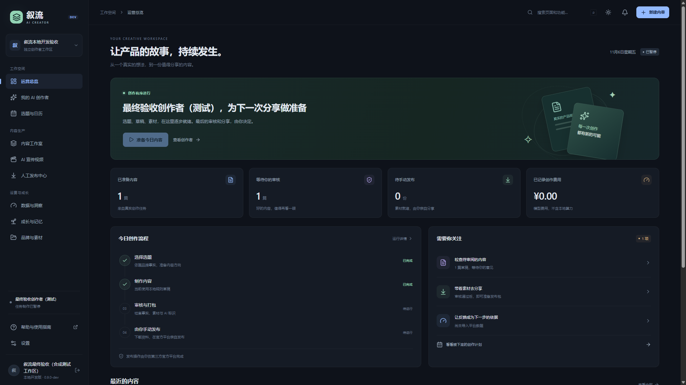

# 叙流 · AI 持续创作者

让产品的故事，持续发生。根据用户提供的 V2.3 设计文档开发。

**当前：0.15.1-dev / 个人本地使用，DB 0014。** 已接通指定内容、分镜、中文系统配音、同步字幕、预览复核和高清导出。软件产品发布片支持原生排版、真实界面特写和声音整理；本次修复慢速镜头坐标取整造成的步进卡顿。真实操作样片和测试范围见 [连续运动验收](docs/implementation/SMOOTH_CAMERA_VALIDATION.md)。DeepSeek 负责文字，声音由本机系统合成；音色及艺术效果仍需人工判断。详细状态见 [PROJECT_STATUS.md](PROJECT_STATUS.md)。

AI 负责准备内容；你在第三方平台官方页面亲自上传并发布。软件不需要社媒凭据，登记始终显示“用户自行登记，未经平台验证”。



## 本地启动

需要 Node.js 22.9+、Python 3.12、FFmpeg 和 ffprobe。Windows 可使用现有 Python Launcher；请从项目根目录执行：

```powershell
py -3.12 -m venv .venv
.\.venv\Scripts\python.exe -m pip install -r requirements.lock.txt
npm.cmd ci
npm.cmd run dev
```

macOS / Linux：

```bash
python3.12 -m venv .venv
.venv/bin/python -m pip install -r requirements.lock.txt
npm ci
npm run dev
```

打开 **http://localhost:3000**。`npm run dev` 会先运行本地迁移，再启动 Web、API 和独立后台 Worker。请使用 `localhost`；若改成其他站点域名，须在 `.env` 配置一致的 `WEB_ORIGIN`，否则写操作会因来源校验被拒绝。

首次注册你自己的工作区；不会自动填充示例内容。依次添加品牌和带来源的事实 → 保存创作者 → 准备今日图文 → 编辑并人工审核 → 准备发布包 → 下载。在官方平台亲自发布后，再回软件完成五项检查并登记。

数据实际保存在 `.data/`；不要删除此目录或提交到 Git。首次开发启动生成本地会话密钥，不需要填写社媒账号信息。`Ctrl+C` 停止当前启动器；已经保存的任务会在下次启动继续处理。

## 能实际操作的功能

- 邮箱注册、密码哈希、JWT HttpOnly 会话和退出撤销；所有业务资源按工作区隔离。
- 一个品牌、一个创作者：事实来源与用户核实、时区、每周频率、预算、暂停/恢复、日任务幂等、真实持久化的 14 天计划。
- 选题可编辑、锁定、跳过、交换日期；改题后重新确认。每次最多确认提前准备 7 篇，执行依据冻结，模型预算计入实际执行日；默认七种规则稿结构；模型相近主题建议需单独授权和人工复核，不宣称平台热度。
- 可编辑 1–6 页图文：三版式、三尺寸与三主题，真实截图保留完整比例；真实 PNG/JPG 预览、人工复核、单页下载及全部图文 ZIP，附工程 JSON、事实/素材来源和哈希。
- LangGraph 事实约束流程；默认明确标注 **本地规则草稿**。编辑后必须重新审核，品牌事实变更会使待发布包失效。
- 本地 MG 动画（Pillow）与真实素材/录屏混剪（FFmpeg）；独立 VideoProjectIR、镜头级修改、内容缓存、1920×1080 或 1080×1920 MP4、工程 JSON 导出。支持字幕/SRT、授权旁白/BGM 混音、三种比例、分镜排序锁定与历史恢复；可选 Windows 离线配音需核实许可。
- 真正生成 PNG 封面、文案、出处与检查表的 ZIP 文件；无任何第三方平台发帖请求。
- 用户自报登记及撤销；CSV / XLSX 校验预览、确认、幂等导入、来源与窗口分组、缺失值保留 NULL。
- 事实变化提案审批、内容版本比较/恢复与平台文案；站内提醒、交接结果、私有记录导出。
- 手工反馈/指标与字段映射、规则报告、策略审批/拒绝/回滚，后续计划冻结用户批准的偏好。
- 可显式开启日更图文/视频制作，媒体失败只恢复媒体步骤，不重复模型生成。
- 独立模型设置与显式联调；授权公开 Release/文档或上传版本说明的快照、差异和素材版本复核。
- 版本绑定的质量报告、近 30 条标题与近 10 条镜头结构提示、可选预算模型建议；新界面工程先生成带水印低清预览，记录确认后才生成高清，预览不能打包发布。
- [指定内容创作](http://localhost:3000/studio/briefs/new)：需求和脚本分版本保存，逐镜头编辑、确认后建立视频；原文模式不调用模型，AI 写稿单独授权且共享预算。实际步骤与验收见 [指定内容创作验收](docs/implementation/USER_DIRECTED_CREATION_VALIDATION.md)。
- 本地配音与完整制作：逐镜头旁白、真实系统声音、语速、固定或自适应时长、同步字幕与自动音轨合成；显示后台进度、试听及失败原因。录屏较短时停留末帧，保留完整旁白。见 [带声音的样片](docs/evidence/narrated-mixed-11s.mp4) 和 [完整流程验收](docs/implementation/NARRATED_VIDEO_VALIDATION.md)。
- 请求 / 任务 / 镜头诊断、OpenTelemetry spans、版本快照、管理员事件查询、深浅主题与移动布局。

30 秒最终验收片：[MG](docs/evidence/final-mg-30s.mp4)、[真实软件录屏](docs/evidence/final-screen-30s.mp4)、[混合](docs/evidence/final-mixed-30s.mp4)，均为 1920×1080 / H.264 + 验收音调 / AAC，有字幕与来源回执，不是营销效果证据。

早期 20 秒双引擎 PoC（MG + 本软件实际截图 + MG）：[MP4](docs/evidence/mixed-20s.mp4)、[工程](docs/evidence/video-project.json)、[ffprobe 与缓存回执](docs/evidence/video-receipts.json)。这是验收产物，未包含旁白或配乐，不代表商业素材已获许可。

## 可选真实模型

默认不会调用收费模型。设置页可保存允许的 HTTPS 网关、模型名称、单价（整数分 / 百万 token）、价格来源和输出上限。密钥由独立 Fernet 主密钥加密存储，页面不回显，也不进入 Prompt/快照/导出；保存设置不会发起模型请求。生产必须独立配置并保管 `MODEL_ENCRYPTION_KEY`。已有服务端环境配置仍可兼容，端点须列入 `MODEL_ALLOWED_HOSTS`。

随后在创作者设置中明确授权发送已核实品牌事实，并配置足够预算。系统先预留费用、再请求模型；超时或回执/费用不确定时暂停，**不会自动再次付费生成**。价格来自操作者配置，账本是按用量和该报价计算的整数分估算，供应商实际扣款以其账单为准。2026-11-06 经用户授权，DeepSeek 官方模型列表、固定 JSON 测试及质量建议均成功；凭据仅在本机加密保存。复盘和质量建议都须单独授权、人工复核，未知费用可录入有来源的自报核对结果，不重发旧请求。详见 [本轮验收](docs/implementation/CREATIVE_QUALITY_VALIDATION.md)。

## 数据库与任务部署

本地使用 SQLite + 磁盘，Worker 独立轮询数据库，Web 内没有定时任务。跨进程通过唯一日键与租约抢占；重启会恢复已入队安全任务。停机错过的历史日期不自动补写，恢复当天按时区安排，避免突然批量消费预算。

部署配置提供 PostgreSQL + Redis / Celery：先设置 `POSTGRES_PASSWORD`，运行 `docker compose -f infra/docker-compose.yml up -d`，再配置 `DATABASE_URL` 和 `REDIS_URL`。不要对生产环境直接运行迁移命令；先备份并演练。

```bash
# 显式迁移（本地 / 隔离验收环境）
python -m alembic upgrade head
# Celery 部署时用以下进程替代本地轮询 Worker，不要重复启动两套调度器
celery -A creator.celery_app:app worker --loglevel=info
celery -A creator.celery_app:app beat --loglevel=info
```

单独启动 Python 入口前须设置 `PYTHONPATH=services/api`。生产模式要求 PostgreSQL、`COOKIE_SECURE=true`、至少 32 字符的 `JWT_SECRET`、HTTPS 和正确的站点来源。当前仍未提供 S3、支付、邮箱验证/找回、完整限流与生产可用性设施，不应直接作为公网商业服务上线。

## 检查与文档

```powershell
.\.venv\Scripts\python.exe -m pytest -q
.\.venv\Scripts\python.exe -m ruff check services tests infra scripts
npm.cmd run typecheck
npm.cmd run build
npm.cmd run check:boundary
```

本轮已运行的命令、结果、浏览器证据与未运行项：[最终集成验收](docs/implementation/FINAL_ACCEPTANCE.md)。CI 同时测试 SQLite 与 PostgreSQL；应以实际 Actions 结果为准。

- [实际模块地图](docs/architecture/IMPLEMENTED_MODULES.md) / [页面对应表](docs/implementation/ROUTES.md)
- [OpenAPI](packages/schemas/openapi.json)，API 启动后 http://localhost:8000/api/docs
- [实际操作手册](docs/implementation/LOCAL_USER_GUIDE.md) / [备份与恢复](docs/implementation/RECOVERY.md)
- [M0 基线任务](docs/implementation/M0_TASK.md) / [本轮 M1 任务](docs/implementation/M1_TASK.md) / [本轮验收](docs/implementation/M1_VALIDATION.md) / [许可证与供应链台账](LICENSE_INVENTORY.md)
- [原始业务基线](docs/01_产品完整开发方案_人工发布版.md)；`开发文档/` 中的用户原始设计包保留不动。

本轮图文卡：[开发任务](docs/implementation/M2_GRAPHICS_TASK.md)、[验收记录](docs/implementation/M2_GRAPHICS_VALIDATION.md)。入口为内容详情的“编辑封面与图文卡”或“封面模板”页面。


0.15.0-dev 新增软件产品发布片：原生分辨率分层排版、真实界面并排与特写、功能/步骤/收尾、品牌主题和镜头运动，及可选响度整理/旁白压低配乐。仍需用户准备真实授权素材并播放复核。无云视频、无新增模型费用；详见 [本轮验收](docs/implementation/SOFTWARE_FILM_VALIDATION.md)。

新样片：[软件产品发布片 · 35.5 秒 / 中文配音](docs/evidence/software-product-film-35s.mp4)，为本仓库真实界面与合成验收工作区，未使用背景音乐或虚构经营指标。
