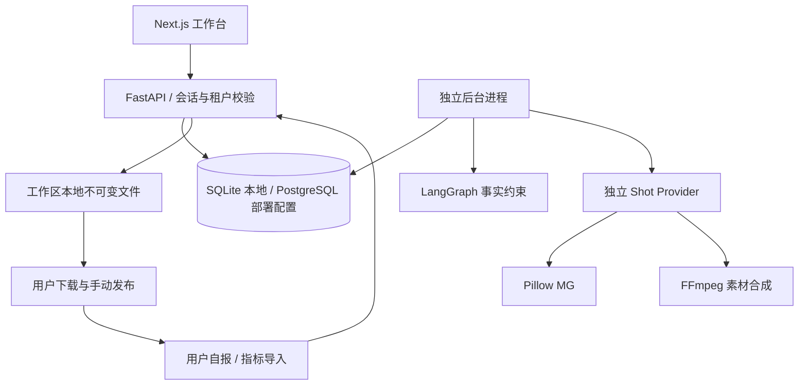

# 实际模块地图 · 0.12.0-dev

原 `MODULE_MAP.md` 为目标架构；此表索引本轮实际代码，模块负责人均为仓库维护者。

| module_id | 代码 | 责任与验收 |
|---|---|---|
| WEB-SHELL | `apps/web/components/workspace.tsx`、`packages/ui` | 导航、会话、深浅主题、错误态、响应式 |
| WEB-PAGES | `apps/web/components/pages/*` | 各业务页面独立模块，全部从 API 读写 |
| AUTH | `services/api/creator/auth.py`、`main.py` | JWT 会话、密码哈希、归属与来源校验；safety 测试 |
| BRAND | `models.py`、`schemas.py`、`main.py` | 事实与素材来源、哈希、锁定、失效传播 |
| CREATOR | `jobs.py`、`worker.py`、`celery_app.py` | 唯一日键、时区、预算、暂停、租约恢复 |
| EDITORIAL | `editorial.py`、`editorial_api.py`、`pages/editorial.tsx` | 持久化 14 日计划、乐观锁、事实时效、日期交换、确认与批量备稿；`test_editorial.py` |
| AGENT | `agent.py` | LangGraph 事实筛选 → 规则或真实模型；默认禁用外部追踪 |
| CONTENT | `domains.py`、`main.py` | 编辑版本、确定性预审、人工审核、品牌事实绑定 |
| GRAPHICS | `graphics.py`、`graphics_api.py`、`pages/graphics.tsx` | 独立图文 IR 1.0，三版式/三尺寸、PNG/JPG、真实预览、来源/哈希与发布包；`test_graphics.py` |
| VIDEO | `video.py`、`schemas.py` | 独立 IR、Pillow / FFmpeg 镜头、缓存、ffprobe |
| HANDOFF | `domains.py`、`main.py` | 真实 ZIP、过期检查、手动登记和撤销，无平台写网络 |
| METRICS | `domains.py`、`main.py` | 字段匹配/手工指标/版本、NULL、日期/来源、幂等与分组 |
| OBS | `observability.py`、`job_events` | OTel 上下文、错误码、脱敏事件、运行版本 |
| OPS | `infra/migrations`、`.github`、`release_manifest.json` | 迁移、检查与开发发行元数据，尚无生产发布 |

API 错误含 `code/message/trace_id/request_id`。HTTP 使用 W3C Trace Context，日任务冻结发行信息与选题快照；安全日志不记录 Prompt 原文、密钥和原始私有文件路径。实际 OpenAPI 由 `scripts/export-contracts.py` 从实现生成。运行回执沿用 `engineering/contracts/runtime_receipt.schema.json` 并用真实数据库事件验证。

M1 调用链：编辑/确认选题 → 日程或显式备稿 → `enqueue` 保存 `input_snapshot` → 版本、事实、暂停、实际计费日预算校验 → LangGraph → 既有内容审核与人工发布包。GET 计划只读取，补齐计划为 POST；新创作者/Worker 依照已开启设置维护规则计划。规则选题自动确认，手动修改后进入 `planned`。此处描述当时 M1 增量；当前视频见下方 B。

M2 图文调用链：图文编辑器 → 带内容版本的工程保存 → Content 图文 JSON（0003）→ 授权/事实/字数检查 → Pillow PNG/JPG 与字体/文件回执 → 逐页查看、人工审核 → 同一文件进入全部图文 ZIP。正文与图文共享内容 revision；预览 GET 不自动生成，不改变审核状态。无需模型网络请求，视频和 Agent 版本保持原值。

A / #7：EVIDENCE 模块位于 `evidence.py`、`evidence_api.py`、`pages/evidence.tsx`；0004 增加私有内容快照、品牌变更提案及平台文案。事实审批使待发布稿失效，历史登记不变。

B / #9：VIDEO 新增 `video_edit.py`、`video_edit_api.py`、`video_audio.py`、`speech.py`、`pages/video-editor.tsx`，IR 1.1 / pillow_ffmpeg@2 / DB 0005。已完成旧片可读取，旧版未完成渲染明确阻断、用户保存升级后重建。视频绑定经内容预审后进入人工 ZIP。

C / #11：LEARNING 位于 `learning.py`、`learning_api.py`、`metrics_io.py`、`pages/learning.tsx`；0006 为指标 active、私有反馈、不可变报告、策略审批与指针、计划策略快照。Worker 仅为 active 创作者自动整理上一完整周；只读查询不发起模型调用。

D / #13：SETTINGS/NOTIFY 位于 `model_config.py`、`settings_api.py`、`notifications.py`、`pages/system-settings.tsx`、`handoff-outcome.tsx`、`ops-console.tsx`。DB 0007；配置仅加密存储，任务冻结工作区修订并检查授权/预算，站内提醒无社媒外呼。

E / #15：PRODUCTION 模块 `production.py`，新增 Creator.render_options / 0008。Run.release 冻结本地制作配置和资产哈希；先保存草稿与实际模型费用，再制作图文或排队视频。暂停、过期依据、失败恢复和媒体完成接入既有 Run/Content 审核状态，禁止自动发布。

0.9.0 / #17：`analysis_api.py → analysis_jobs.py → jobs.reserve_budget` 维护独立复盘任务；`learning.py` 保留确定性证据，模型只能追加待审解释。`analysis_api.reconcile` 保存未知费用的人工来源与整数分，不重发请求。0009 扩展指标版本、唯一 AI 报告关联和费用核对。

#19 集成：下载通过 `domains.verified_file` 校验原始素材、人工 ZIP 和含素材的私有导出；缺失/损坏明确阻断。`pages/evidence.tsx` 的未保存平台文案同时阻止历史恢复和平台切换。实际浏览器/三种 30 秒成片证据在 FINAL_ACCEPTANCE.md。

#21 / 0.10：`model_diagnostics.py` / `model_gateway.py` / `pages/model-settings.tsx`，0010。独立模型配置与列表检查、固定 JSON 预算联调；Agent/学习复盘共享兼容参数，旧请求参数仍为默认值。联调不创建日更内容，不发送品牌资料。

#23：`source_http.py` 公网 IP 固定 HTTPS；`product_monitor.py` 快照/差异/租约/Worker 轮询；`product_sources_api.py` 来源/上传/提案/素材版本；`pages/product-sources.tsx` 品牌与素材界面。0011 增加来源、快照、事件、检查与可空素材关联；`evidence.invalidate_asset` 同时复核图文/视频引用的未登记稿。

#25：`quality.py` 冻结规则与来源、标题和镜头比较；`quality_api.py` 租户内报告/预览/人工确认；`quality_jobs.py` 单独授权的预算模型建议，复用一次性网关和未知费用处理。`pages/quality.tsx` 接入内容和视频工作室；`video.py` 单独 purpose=preview/final，真实水印与尺寸探针；`production.preview_ready` 在自动任务中等待复核。0012 新增质量表、视频政策与任务用途；`video_edit.current_output` 拒绝不再有效的确认，附件只取 final 回执。Session 不自动过期，网络/渲染后显式刷新品牌、素材与工程，再判断版本；竞态测试覆盖渲染期间修改。`compatible_chat@2` 冻结在公开配置 hash 中，DeepSeek 官方 JSON 使用已核实的非思考参数。真实联调和 30 秒预览/高清证据见 CREATIVE_QUALITY_VALIDATION.md。
