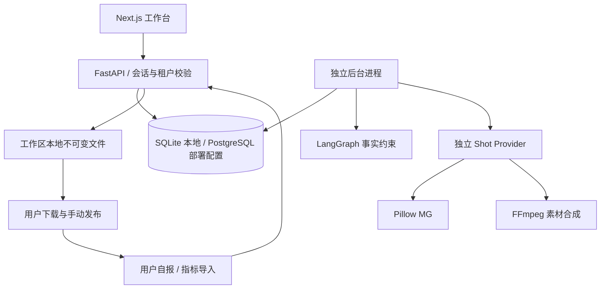

# 实际模块地图 · M0-001

原 `MODULE_MAP.md` 为目标架构；此表索引本轮实际代码，模块负责人均为仓库维护者。

| module_id | 代码 | 责任与验收 |
|---|---|---|
| WEB-SHELL | `apps/web/components/workspace.tsx`、`packages/ui` | 导航、会话、深浅主题、错误态、响应式 |
| WEB-PAGES | `apps/web/components/pages/*` | 各业务页面独立模块，全部从 API 读写 |
| AUTH | `services/api/creator/auth.py`、`main.py` | JWT 会话、密码哈希、归属与来源校验；safety 测试 |
| BRAND | `models.py`、`schemas.py`、`main.py` | 事实与素材来源、哈希、锁定、失效传播 |
| CREATOR | `jobs.py`、`worker.py`、`celery_app.py` | 唯一日键、时区、预算、暂停、租约恢复 |
| AGENT | `agent.py` | LangGraph 事实筛选 → 规则或真实模型；默认禁用外部追踪 |
| CONTENT | `domains.py`、`main.py` | 编辑版本、确定性预审、人工审核、品牌事实绑定 |
| VIDEO | `video.py`、`schemas.py` | 独立 IR、Pillow / FFmpeg 镜头、缓存、ffprobe |
| HANDOFF | `domains.py`、`main.py` | 真实 ZIP、过期检查、手动登记和撤销，无平台写网络 |
| METRICS | `domains.py`、`main.py` | 固定模板导入、NULL、日期/来源、幂等与分组 |
| OBS | `observability.py`、`job_events` | OTel 上下文、错误码、脱敏事件、运行版本 |
| OPS | `infra/migrations`、`.github`、`release_manifest.json` | 迁移、检查与开发发行元数据，尚无生产发布 |

API 错误含 `code/message/trace_id/request_id`。HTTP 使用 W3C Trace Context，日任务冻结发行信息；安全日志不记录 Prompt 原文、密钥和原始私有文件路径。实际 OpenAPI 由 `scripts/export-contracts.py` 从实现生成。运行回执沿用 `engineering/contracts/runtime_receipt.schema.json` 并用真实数据库事件验证。
