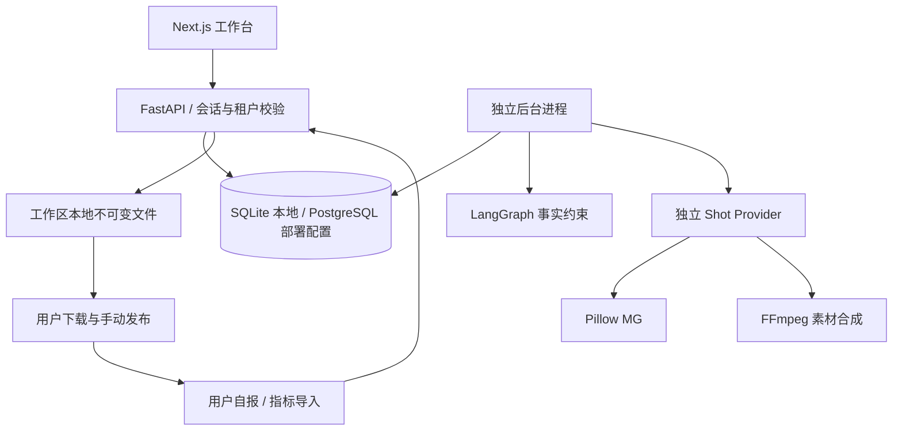

# 实际模块地图 · M0-001 / M1-002

原 `MODULE_MAP.md` 为目标架构；此表索引本轮实际代码，模块负责人均为仓库维护者。

| module_id | 代码 | 责任与验收 |
|---|---|---|
| WEB-SHELL | `apps/web/components/workspace.tsx`、`packages/ui` | 导航、会话、深浅主题、错误态、响应式 |
| WEB-PAGES | `apps/web/components/pages/*` | 各业务页面独立模块，全部从 API 读写 |
| AUTH | `services/api/creator/auth.py`、`main.py` | JWT 会话、密码哈希、归属与来源校验；safety 测试 |
| BRAND | `models.py`、`schemas.py`、`main.py` | 事实与素材来源、哈希、锁定、失效传播 |
| CREATOR | `jobs.py`、`worker.py`、`celery_app.py` | 唯一日键、时区、预算、暂停、租约恢复 |
| EDITORIAL | `editorial.py`、`editorial_api.py`、`pages/editorial.tsx` | 持久化 14 日计划、乐观锁、事实时效、日期交换、确认与批量备稿；`test_editorial.py` |
| AGENT | `agent.py` | LangGraph 事实筛选 → 规则或真实模型；默认禁用外部追踪 |
| CONTENT | `domains.py`、`main.py` | 编辑版本、确定性预审、人工审核、品牌事实绑定 |
| GRAPHICS | `graphics.py`、`graphics_api.py`、`pages/graphics.tsx` | 独立图文 IR 1.0，三版式/三尺寸、PNG/JPG、真实预览、来源/哈希与发布包；`test_graphics.py` |
| VIDEO | `video.py`、`schemas.py` | 独立 IR、Pillow / FFmpeg 镜头、缓存、ffprobe |
| HANDOFF | `domains.py`、`main.py` | 真实 ZIP、过期检查、手动登记和撤销，无平台写网络 |
| METRICS | `domains.py`、`main.py` | 固定模板导入、NULL、日期/来源、幂等与分组 |
| OBS | `observability.py`、`job_events` | OTel 上下文、错误码、脱敏事件、运行版本 |
| OPS | `infra/migrations`、`.github`、`release_manifest.json` | 迁移、检查与开发发行元数据，尚无生产发布 |

API 错误含 `code/message/trace_id/request_id`。HTTP 使用 W3C Trace Context，日任务冻结发行信息与选题快照；安全日志不记录 Prompt 原文、密钥和原始私有文件路径。实际 OpenAPI 由 `scripts/export-contracts.py` 从实现生成。运行回执沿用 `engineering/contracts/runtime_receipt.schema.json` 并用真实数据库事件验证。

M1 调用链：编辑/确认选题 → 日程或显式备稿 → `enqueue` 保存 `input_snapshot` → 版本、事实、暂停、实际计费日预算校验 → LangGraph → 既有内容审核与人工发布包。GET 计划只读取，补齐计划为 POST；新创作者/Worker 依照已开启设置维护规则计划。规则选题自动确认，手动修改后进入 `planned`。视频模块未改动。

M2 图文调用链：图文编辑器 → 带内容版本的工程保存 → Content 图文 JSON（0003）→ 授权/事实/字数检查 → Pillow PNG/JPG 与字体/文件回执 → 逐页查看、人工审核 → 同一文件进入全部图文 ZIP。正文与图文共享内容 revision；预览 GET 不自动生成，不改变审核状态。无需模型网络请求，视频和 Agent 版本保持原值。

A / #7：EVIDENCE 模块位于 `evidence.py`、`evidence_api.py`、`pages/evidence.tsx`；0004 增加私有内容快照、品牌变更提案及平台文案。事实审批使待发布稿失效，历史登记不变。

B / #9：VIDEO 新增 `video_edit.py`、`video_edit_api.py`、`video_audio.py`、`speech.py`、`pages/video-editor.tsx`，IR 1.1 / pillow_ffmpeg@2 / DB 0005。已完成旧片可读取，旧版未完成渲染明确阻断、用户保存升级后重建。视频绑定经内容预审后进入人工 ZIP。

C / #11：LEARNING 位于 `learning.py`、`learning_api.py`、`metrics_io.py`、`pages/learning.tsx`；0006 为指标 active、私有反馈、不可变报告、策略审批与指针、计划策略快照。Worker 仅为 active 创作者自动整理上一完整周；只读查询不发起模型调用。
